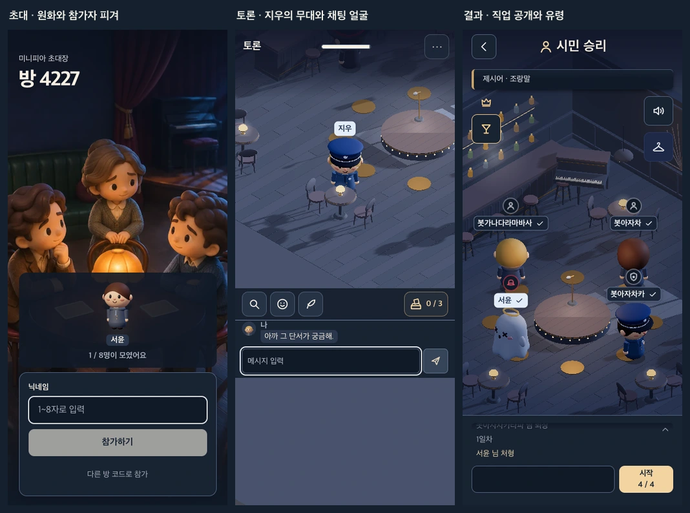
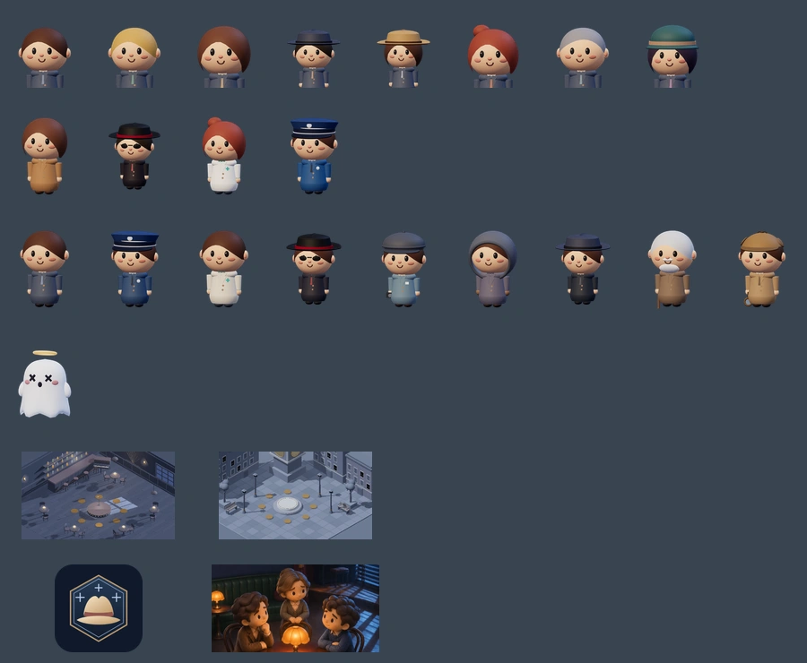
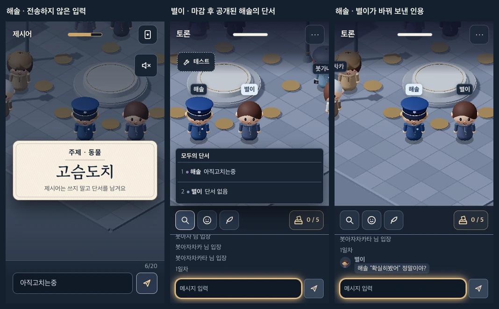

# 미니피아 전면 재평가와 개편 우선순위

2026-11-19 · 게임 아트디렉터, 모바일 UX 디자이너, 게임 디렉터의 독립 재검토와 로컬 플레이 재현을 합쳤다. 현행 v3의 실행 코드 기준은 `ff470bb1`이다. 기존 브라우저 캡처와 앱에 실제 들어가는 에셋을 비교했고, 이번에는 **360×640 Chrome 두 창과 봇 여섯을 넣은 일반 규칙 테스트방**에서 광장 첫 단서→공개→인용 전송을 직접 조작했다. 표결·역할 수·밤 마감의 경계 사례는 서버 판정 함수를 실행해 확인했다. 같은 자리에 모인 친구들의 반응, 실물 폰 스피커와 키보드, 재경기 의향은 이번에 측정하지 않았다. [첫 평가와 시제품 후보](redesign-review-2026-11-19.md)

## 먼저 바꿀 다섯 가지

| 순서 | 현행에서 실제로 벌어지는 일 | 개편 결정안 |
|---|---|---|
| 1 | 초대 원화, 대기실 모델, 채팅 얼굴, 역할 카드, 결과 의상이 한 사람을 서로 다르게 그린다. 의사가 없는 4인판에도 의사 가운이 자동 배정된다. | 실제 플레이 캐릭터를 기준으로 홈부터 결과까지 같은 인물을 추적할 수 있게 한다. 공개 의상에서 실제 직업을 뜻하는 제복을 뺀다. |
| 2 | 전송하지 않은 초안이 마감 뒤 본인 이름으로 공개된다. 그 말을 인용하면 다른 사람이 따옴표 안까지 바꿔 보낼 수 있다. | 작성 중·공개 완료를 구분한다. 인용은 원문을 보존하고 반론은 별도 입력한다. |
| 3 | 토론 종료, 처형 실시, 후보 지목이 각각 다른 의사결정인데 요청 인원과 투표 수로 비슷하게 보인다. 8명 중 한 사람만 투표해도 처형이 가능하다. | 전원이 같은 안건을 보게 하고, 매일 한 번의 동시 표결과 보류를 시험한다. 미응답과 적극적인 보류의 처리도 함께 결정한다. |
| 4 | 두 마피아가 다른 대상을 골라도 모두가 조작했다는 이유로 밤이 1.5초 뒤 끝날 수 있다. 4인과 6인은 첫 오판을 되돌릴 둘째 날이 오지 않을 수 있다. | 역할별 완료의 뜻을 바로잡고, 같은 마감을 전원에게 보여 준다. 인원별로 첫 판단을 고칠 기회가 있었는지 따로 본다. |
| 5 | 실험방에서는 둘째 날 단서 도구가 기다리는 유언을 밤 희생자가 생전에 쓸 기회가 없다. 첫 탈락자는 정답을 보면서 다음 판을 기다리고, 미준비자는 재경기에서 빠질 수 있다. | 다음 날에는 이전 발언과 오늘의 사건을 직접 연결한다. 탈락·복귀·다시 하기에 당사자의 선택을 둔다. |

## 1. 같은 사람을 다시 알아볼 수 있는가

**초대부터 충돌한다.** 홈의 세 사람은 따뜻한 램프 아래서 서로 눈치를 보고 있다. 초대 화면에서는 그 세 사람 바로 앞에 ‘먼저 들어온 서윤’의 작은 게임 피겨가 뜬다. 유저는 방에 들어가기도 전에 두 종류의 등장인물을 한 화면에서 본다. 큰 세 사람 중 누가 참가자인지, 작은 서윤은 왜 다른 그림체인지 화면이 설명하지 못한다. 추천은 **실제 세 캐릭터로 이 장면을 다시 연출**하는 것이다. 램프와 눈 맞춤은 살린다. 홈 원화의 얼굴이 원하는 게임이라면 반대로 그 세 사람부터 플레이 모델과 초상으로 만든다. 어느 방향이든 초대 명단의 피겨도 공개 외형을 따라야 한다. [초대 화면](../src/screens/JoinByLink.tsx) · [공유 이미지](../scripts/make-og.mjs)

**게임이 먼저 잘못된 단서를 준다.** 일반방에서 네 명 모두 옷을 안 고르면 중복을 푸는 규칙이 좌석순으로 기본 코트·경찰·의사·마피아 옷을 입힌다. 실제 배역은 마피아 1, 경찰 1, 시민 2다. “저 사람은 의사 같아”는 미숙한 플레이어의 억측만으로 생기지 않는다. 게임이 의사 가운을 입혀 놓았다. 결과에서는 살아 있는 사람이 실제 직업 옷으로 갈아입어 **같은 제복의 뜻이 판 중간에 뒤집힌다.** 실험방은 시작 시 이 의상 충돌 해소를 건너뛴다. 처방은 8인 모두에게 식별 가능한 머리 윤곽·옷깃·안경 등 일상복을 주고, 제복은 비공개 카드와 게임 종료 뒤에 쓰는 것이다. [시작 의상](../shared/game/look.ts) · [방별 분기](../shared/game/room.ts) · [직업 공개](../src/game/resultDirector.ts)

**한 화면 안에서도 얼굴이 바뀐다.** 일반방에서 지우는 무대 위 경찰모를 썼는데 자기 채팅 ‘나’ 옆에는 금발 맨머리가 뜬다. 현재 좌석 원형 여덟과 기본 초상 여덟은 실제로 서로 대응한다. 어긋나는 곳은 그 위에 의상을 입힌 다음이다. 옷장 미리보기 아홉 장은 같은 기준 모델로 만들고, ‘내 역할’의 직업 원화도 플레이어와 무관한 고정 모델을 쓴다. 직업 삽화를 쓸 경우 ‘시민이란 어떤 역할인가’를 보여 주는 도감으로 표현한다. 나를 가리키는 채팅·후보·제외 확인에는 항상 내 공개 초상과 이름을 쓴다. [초상·역할·옷장 생성](../scripts/render-noir-assets.mjs) · [채팅 얼굴](../src/components/v2/ChatLines.tsx)

**배경에는 장소가 있고 토론에는 상대가 없다.** 재즈 바의 피아노와 광장 시계탑은 두 장소를 구분해 준다. 반면 실제 폰의 토론 카메라에서는 바닥, 머리 위, 공통 금빛 원판이 크게 보이고 말을 건 친구는 작은 채팅 얼굴로 밀려난다. 원판은 집결 자리 표식이다. 신규 참가자가 눌러야 할 물건으로 보는지는 확인이 필요하다. 자유 이동은 대기실에 두고, 토론 때에는 4인 고정 테이블과 8인 발언자 확대+얼굴 목록을 비교한다. 바는 램프와 피아노, 광장은 시계와 가로등을 화면 가장자리에 남긴다. 시선이 처음 닿는 곳에는 발언자와 방금 한 말을 둔다. 금빛은 실제 선택과 내 차례에 쓰고, 자리 표식은 집결 때만 켠다. [재즈 바](../src/world/maps/bar.ts) · [시계탑 광장](../src/world/maps/plaza.ts) · [일반방 토론 실화면](../design/v3.0/review-2026-11-19/game-390x844-normal-discussion.png)

**결과와 브랜드에서도 의미를 분리해야 한다.** 탈락하면 모두 같은 유령이 되고, 결과의 역할은 이름표 위 작은 도형에 의존한다. 친구가 가장 궁금한 순간에는 “서윤 · 마피아 · 첫날 처형”을 읽을 수 있어야 한다. 생전의 머리 장식 하나를 유령에게 남기고 이름·역할·결말을 읽을 수 있는 명단을 둔다. 설치 아이콘의 페도라, 원화의 램프, 마피아 역할의 모자도 역할이 겹친다. 브랜드를 램프로 통일할지는 후보지만, 적어도 ‘마피아’와 ‘게임 전체’를 같은 모자로 읽게 하는지는 작은 아이콘 크기에서 확인한다. [역할 칩](../src/components/v2/RoleChip.tsx) · [결과 화면](../src/screens/ResultScreen.tsx) · [앱 아이콘](../scripts/make-noir-brand.mjs)

## 2. 한 사람이 방에 들어와 결정을 내리기까지

| 장면과 관점 | 현재 화면·동작의 문제 | 고치는 방법 |
|---|---|---|
| 홈·초대·대기실 | 세 사람이 보이는 홈에서 몇 명을 모아야 하는지 알기 어렵다. 입장 후 방장에게 뜨는 `시작 3/8`의 8은 정원이고 실제 최소는 4명이다. 만석 링크는 10초마다 자리를 다시 확인하면서 화면에는 `처음으로`만 둔다. | 방 만들기 옆에 `4~8명`, 세 명인 방에는 `한 명 더 오면 시작`과 `친구 초대`. 만석에는 `빈자리가 생기면 여기서 참가할 수 있어요`, 만료에는 `다른 코드 입력`. [홈](../src/screens/Home.tsx) · [대기실](../src/screens/Lobby.tsx) · [초대 상태](../src/screens/JoinByLink.tsx) |
| 비공개 역할 | 일반방은 5초가 지나면 가만히 둔 카드도 앞면으로 바뀐다. 그 뒤 같은 단계에 복귀하면 앞면으로 시작한다. 실험방은 처음부터 앞면이고 준비 체크 후에도 다른 사람이 준비하는 동안 역할이 보인다. 대면에서 실제 노출 빈도는 미측정이다. | `내 역할 보기`로 직접 열고 `봤어요`로 가린다. 폰을 내려놓거나 돌아왔을 때 기본값은 뒷면. 손을 계속 대기 어려운 사람에게 탭으로 열고 닫는 조작도 제공한다. [일반 카드 전환](../src/net/cardFace.ts) · [실험방 역할 확인](../src/screens/RoleReveal.tsx) |
| 단서 제출 | 일반방은 읽기 3초, 작성 10초다. 전송하지 않은 유효 초안까지 마감에 공개되고 늦은 제출 순서가 표시된다. 일반 마피아에게도 제시어 자리는 `???`이고 안내는 “제시어는 쓰지 말고”다. 실험방은 적기 전 입력 예시가 역할에 맞게 달라진다. | 추천은 **명시적으로 제출한 답만 공개**하고 초안은 개인에게 보존하는 안이다. 빈칸이 많아지면 입력 시간·예시를 고친다. 좌석순 동시 공개로 입력 속도를 추리 단서에서 뺀다. 마피아에게는 `주제만 보고 들키지 않을 단서를 써요`. [화면](../src/screens/Keyword.tsx) · [마감 규칙](../shared/game/keywordAnswer.ts) |
| 단어 편집 | “제시어는 쓰지 말고 단서를 남겨요”를 따라 ‘극한직업’에 ‘치킨집’을 쓰거나 ‘겨울왕국’에 ‘엘사’를 써도 거절된다. 작품명과 대표 연상어가 같은 금지 목록에 들어 있다. | 첫 판은 제시어 자체·표기 변형·직접 번역을 금지하는 원칙으로 목록을 편집한다. 강한 연상어를 쓴 사람이 왜 그 말을 골랐는지는 토론의 소재로 남긴다. 너무 쉽게 맞히는 제시어는 별도 교체한다. [실제 단어 목록](../shared/game/keywords.ts) · [판정](../shared/game/keywordGuard.ts) |
| 단서 찾기·인용 | 돋보기 속 공개 답을 누르면 작성자와 내용이 편집 가능한 평문으로 바뀐다. 따옴표 안을 고쳐도 받는 화면에서 원문으로 돌아갈 수 없다. 채팅 발신자 이름은 표시된다. | 첫 단서 한 줄을 작성자 아래에 노출한다. `이 말에 질문`을 누르면 원문·작성자가 붙은 인용 카드가 생기고 그 아래만 편집한다. 마피아가 자유롭게 사실과 다른 주장을 할 수 있고, 모두가 원문은 대조할 수 있게 한다. [인용 형식](../src/game/discussionEvidence.ts) · [입력·전송](../src/components/v2/ChatPanel.tsx) |
| 의심 표시 | 딱지 한 장을 붙이면 다른 사람에게 옮길 수만 있고 의심을 거둘 수 없다. 남의 이름표 위 수치는 4장부터인데, 4인판에서는 자기 자신을 제외해 최대 3장이다. 가슴의 종이·기록은 남지만 세 사람이 같은 친구를 의심해도 남의 이름표 집계는 뜨지 않는다. | 사람의 이름에서 `공개 의심 표시 / 거두기`를 제공한다. 1장부터 보이는 안과 대상을 눌러 자발적으로 확인하는 안을 비교한다. 숫자 상시 노출이 무리 짓기를 부추기는지도 본다. [딱지 규칙](../shared/game/postit.ts) · [이름표 문턱](../src/components/v2/HeadStack.tsx) |
| 투표와 스킵 | 토론의 투표함은 모두의 토론을 끝내자는 요청이다. 일반방 찬반은 “오늘 처형할까요?”의 답인데 안건은 화면 읽기 전용이다. 실험방 첫날 표결은 후보·보류·미응답의 결과가 달라도 `오늘은 아무도 지목되지 않았어요`로 합쳐진다. 실제 **개인 스킵**은 결과 초반 무대를 누르는 별도 동작이다. | `토론 마치기 · 3명 동의 필요` → `지우에게 투표 / 오늘은 보류` → `후보 동률로 오늘은 보류`. 개인 연출에만 `내 연출 건너뛰기`를 둔다. 행동의 주체, 대상, 결과를 버튼 옆에서 읽게 한다. [토론](../src/screens/PlaytestDiscussion.tsx) · [첫 표결 결과](../src/screens/GamePanel.tsx) · [개인 스킵](../src/screens/ResultScreen.tsx) |
| 시간·복귀 | 막대의 같은 길이가 10초 입력인지 90초 토론인지 구분하기 어렵다. 재연결 알림은 연결 회복을 알려 주지만, 경찰이 아침 전환을 놓치면 조사 결과 카드가 다시 뜨지 않는다. 개인 일지에 결과는 남는다. | 행동 마감에는 초와 완료 상태를 표시한다. 복귀하면 `끊긴 사이 밤이 끝났어요`와 실제로 생긴 `내 조사 결과 보기`를 당사자에게만 제공한다. [시간 표시](decisions/0098-fixed-chat-and-phase-gauge.md) · [복귀 시 개인 카드 처리](../src/net/useDayFx.ts) |

**두 창에서 재현한 장면.** 해솔이 ‘아직고치는중’이라고 입력한 뒤 전송하지 않았다. 마감 후 별이의 ‘모두의 단서’ 첫 줄에 그 문장이 해솔 이름으로 나타났다. 별이가 그 줄을 눌러 따옴표 안을 ‘확실히봤어’로 고쳐 보냈고, 해솔의 화면에 별이의 채팅으로 도착했다. 이건 발신자 사칭이 아니다. **플레이어가 편집한 주장과 게임이 보존한 원문을 메시지에서 구별할 수 없다는 문제**다.

## 3. 재미와 공정성을 깎는 규칙

**첫 오판을 수정할 기회는 몇 명이 모였는지에 따라 달라진다.** 아래는 첫날 시민 편을 잘못 처형하고 그 밤에 시민 편 한 사람이 죽었을 때다. 의사가 있는 판은 보호 실패를 가정했다. 승률 예측이 아니라 같은 두 사건을 각 인원 구성에 적용한 결과다. 이전 평가의 ‘4인과 6~8인 비교’는 6인의 조기 종료를 가린다. [인원별 배역](../shared/game/roles.ts) · [승리 판정](../shared/game/win.ts)

| 시작 인원 | 시작 마피아 / 시민 편 | 첫 낮·밤 뒤 | 다음 토론 |
|---|---|---|---|
| 4 | 1 / 3 | 1 / 1 | 마피아 승리 |
| 5 | 1 / 4 | 1 / 2 | 진행 |
| 6 | 2 / 4 | 2 / 2 | 마피아 승리 |
| 7 | 2 / 5 | 2 / 3 | 진행 |
| 8 | 2 / 6 | 2 / 4 | 진행 |

- **8명 중 한 명만 행동해도 사람이 죽을 수 있다.** 일반방에서 1명 찬성·7명 미응답은 통과다. 이후 같은 한 사람만 지목해도 유일 최다 후보가 된다. 실험방 첫 투표 역시 실제 보류표와 미응답을 다르게 센다. 동시 표결로 통합할 때 투표 정족수도 함께 설계해야 한다. 최소 참여 인원에 못 미치면 그날은 처형 없이 넘어가는 안을 시험하고, 마피아가 집단 기권을 전략적으로 쓰는 경우도 돌려 본다. [찬반](../shared/game/verdict.ts) · [지목](../shared/game/nomination.ts) · [실험방 첫 투표](../shared/game/playtest.ts)
- **일반방에서는 친구들의 입장 순서가 발언권의 차이가 된다.** 순차 지목은 좌석순이고 한 번 누르면 확정이다. 방장은 늘 0번이고 같은 좌석은 재경기에도 이어진다. 마지막 사람은 앞선 표를 본 뒤 동점을 만들거나 깰 수 있다. 공개 지목의 긴장을 살릴 안은 첫 사람을 날마다 순환시키고, 대안은 동시에 고른 뒤 공개하는 것이다. 조용한 사람에게 유도 질문이 생기는 쪽을 본다. [좌석과 순차 지목](../shared/game/nomination.ts) · [재경기](../shared/game/rematch.ts)
- **마피아 둘에게는 협업을 끝낼 시간이 보장되지 않는다.** 6인에서 두 사람이 다른 대상을 누르고 나머지도 밤 행동을 끝내면, 암살 합의가 없어도 남은 시간이 1.5초로 줄 수 있다. 서로의 수치 배지는 있지만 살아 있는 사람의 밤 채팅 입력은 보이지 않는다. 일반방의 쪽지는 암살 대상 합의 뒤에 열려 팀 대화를 대신할 수도 없다. 팀원에게만 `서로 다른 대상 · 합의 1/2`처럼 알려 주고, 팀 공통 확정 전 첫 탭은 수정 가능한 선택으로 둔다. **공개 마감이 특정 역할의 합의 시각을 드러내지 않도록** 고정 종료 시각 안과 전 역할 공통 완료 절차를 비교한다. [밤 판정](../shared/game/night.ts) · [조기 마감](../shared/game/early.ts) · [밤 버튼](../src/screens/GamePanel.tsx)
- **시민·경찰·의사에게 같은 얼굴 목록은 다른 약속을 한다.** 일반방 시민의 선택은 밤 결과에 효력이 없다. 경찰은 조사 대상의 얼굴과 ‘마피아/아님’을 약 2.4초 보는데, 일반 카드에 닉네임은 이미지 대체 텍스트로만 실린다. 실험방은 이름도 쓴다. 의사 일지는 실제로 고른 대상에 ‘보호’를 표시하고 구출 성공 여부를 별도로 확정하지 않는다. 시민에게는 기다리는 이유와 준비, 경찰에게는 `조사한 지우 · 마피아 아님`, 의사에게는 `지우를 지키기로 선택함`을 제시한다. 능력 효과와 대상은 분명히 하고 역할이 알 수 없는 결과는 주지 않는다. [밤 행동](../shared/game/night.ts) · [경찰 카드](../src/components/PoliceResultCard.tsx) · [직업 일지](../src/game/journalText.ts)
- **실험방 둘째 날은 단서가 생기는 길을 스스로 닫았다.** 둘째 날 돋보기는 해당 아침 희생자의 유언을 찾는다. 실험방의 인간은 낮 처형이 결정된 당사자일 때만 일반 유언 작성 조작이 열려, 밤에 죽을 사람이 미리 쓸 진입점이 없다. 봇은 첫 토론에 유언을 자동으로 써서 봇 테스트에서는 자료가 보일 수 있다. 유언은 선택 기능으로 두고, 기본 자료를 `어제 누가 한 말 / 오늘 모두에게 일어난 일`로 바꾼다. 사망자가 없거나 아침에 재접속해도 질문할 거리가 남아야 한다. [작성 조건](../src/screens/GamePanel.tsx) · [읽는 조건](../src/game/discussionEvidence.ts) · [봇 자동 유언](../shared/game/bots.ts)
- **봇이 인원수는 채워도 대화를 만들어 주지는 않는다.** 이번 8인 캡처의 봇 여섯은 전부 ‘단서 없음’이었다. 토론 문구와 일반 찬반은 실제 발언의 설득력과 무관하다. 마피아 봇에게 동료의 기존 선택이 없으면 가장 낮은 생존 비마피아 좌석을 노려, 시민 편 방장이 반복해서 첫 표적이 될 수 있다. 봇을 쓸 때는 로비부터 사람·연습 상대 수를 나눠 보이고, 밤 기본 표적 편향을 없앤다. 추리의 재미와 역할 밸런스 평가는 사람끼리 한 판으로 잡는다. [봇의 선택 규칙](../shared/game/bots.ts)

## 4. 같은 테이블·다른 기기·판이 끝난 뒤

- **같은 테이블.** 역할 카드를 자동으로 여는 동작 외에도, 소리는 기본 켜짐이고 경찰 결과 카드는 그 기기에만 카드 소리를 예약한다. 모두 같은 종류의 카드음을 써도 어느 폰에서 언제 울리는지는 들릴 수 있다. 소리로 정체를 맞힐 수 있다는 결론은 아직 없다. 4~6대의 폰을 테이블 위에 놓고 친구들이 누구의 음인지 구분하는지, 재즈 루프 여러 개가 대화를 덮는지 확인한다. 식별이 된다면 공통 신호를 한 기기에서 재생하고 개인 알림은 화면·선택 진동으로 주는 안을 시험한다. [소리 기본값](../src/audio/prefs.ts) · [개인 카드음](../src/audio/director.ts)
- **원격 문자·작은 폰.** 대면에서는 눈길이나 침묵으로 보충할 수 있고 원격에서는 작성자·원문·질문이 화면에서 이어져야 한다. 키보드를 연 상태에는 인용 대상 이름과 원문 한 줄을 입력칸 바로 위에 남긴다. 320px 긴 이름 8명과 실제 한글 조합 입력으로, 단서를 보고 답장을 보낸 뒤 같은 친구에게 투표할 수 있는지 확인한다. 채팅 글자 수를 대면 팀의 참여도로 쓰지 않는다. [채팅·단서 패널](../src/screens/PlaytestDiscussion.tsx)
- **화면 읽기와 저사양 기기.** 광장 토론에서 캔버스의 낭독 이름을 실제로 읽으면 “지하 재즈 바 로비. 바닥을 누르면 그쪽으로 걸어가요”였다. 장소와 단계를 고정한 문자열이라 이동이 잠긴 장면에도 맞지 않는다. 결과의 역할 칩에는 접근성 이름이 있으나 선택할 수 없는 월드 이름표가 상위에서 숨겨져 그 경로로는 읽지 못한다. 맵·단계에서 설명을 만들고, 후보와 결과는 장면 밖에도 같은 이름으로 읽히게 한다. WebGL 미지원 상태의 현재 주 행동은 ‘나가기’다. 테이블 시제품의 2D 좌석 명단을 해당 기기의 플레이 경로로도 쓸지 시험한다. [무대와 이름표](../src/components/WorldStage.tsx) · [맵 실패 상태](../src/world/status.ts)
- **첫 탈락자.** 죽는 순간 전체 역할과 밤 행동을 볼 수 있고, 첫 유령은 다른 탈락자가 나올 때까지 유령 채팅을 보낼 상대가 없다. 화면을 흘깃 볼 수 있는 대면 친구에게도, 원격에서 한 판을 더 기다릴 사람에게도 부담이다. `계속 추리하기 / 정체 열어 보기`를 고르게 하고, 개인 예측은 결과에서만 확인하게 한다. 살아 있는 사람에게 정답이 돌아가는 경로는 만들지 않는다. [관전 정보](../shared/game/view.ts) · [채널 분리](../shared/game/audience.ts)
- **결과·재경기.** 승리 진영과 전체 대화는 보이지만 “어떤 말이 거짓이었고 왜 여기서 끝났지?”는 각자 복원해야 한다. 실제 단서 한 줄, 그 뒤의 공개 선택, 끝난 승리 조건을 같은 사람 이름과 연결한다. 재경기는 방장·봇이 자동 준비이며, 남은 자리가 충분하면 방장이 확인한 뒤 미준비 손님을 빼고 시작할 수 있다. 손님은 다음 결과까지 자기 캐릭터와 `이번 판은 쉬어요 / 나가기`만 본다. 방장 확인에는 빠지는 사람의 이름, 손님에게는 `다음 판 참가 / 이번 판 쉬기`와 복귀 시점을 보인다. [결과](../src/screens/ResultScreen.tsx) · [쉬는 화면](../src/screens/BenchView.tsx) · [준비 판정](../shared/game/rematch.ts)

## 5. 제작 순서와 중단 기준

| 단계·담당 | 만들거나 비교할 것 | 다음 투자 판단 |
|---|---|---|
| 1. 아트·UX | 실제 인물 셋으로 초대→대기실→채팅→후보→결과를 한 줄로 만들고, 이름·머리 윤곽·옷깃이 남게 한다. 4인 기본복과 8인 의상 선택을 모두 쓴다. | 제안 기준은 초심자 10명 중 8명 이상이 홈에서 본 인물을 3초 안에 기본 초상과 연결하는 것. 실제 선택 과제에서 다른 친구를 지목하거나 재경기에서 잘못 제외한 장면은 따로 수정한다. |
| 2. UX·서버 | 비공개 역할 열기·가리기, 명시적 단서 제출, 원문 인용, 종료 동의·보류·표결 이유를 작은 폰에 구현한다. | 신규 참가자가 누르기 전 **누구에게 무엇이 공개되는지** 설명할 수 있어야 한다. 보내지 않은 글·바뀐 인용·가려 둔 역할이 의도와 다르게 보이면 규칙 실험보다 먼저 고친다. |
| 3. 게임 디렉터·개발 | 4인과 6인에서 첫날 보류·동시 표결·최소 참여 기준을 비교한다. 6인에서는 두 마피아의 선택을 일부러 엇갈리게 한다. 5·7·8인은 별도 결과로 기록한다. | 1인 단독 처형과 조율할 수 없는 밤이 해소되는지 확인한다. 해결책이 기권만 반복하는 판이나 공개 타이머로 직업을 짐작할 수 있는 판을 만들면 다시 조정한다. |
| 4. 게임 디렉터·리서치 | 전원 인간 대면 팀과 원격 문자 팀으로 둘째 날을 본다. 기존 키워드+사건 기록판과 ‘재즈 바 정전’ 종이 증언판에 같은 시간을 준다. 정전판은 각기 본 것·들은 것이 다르고 다음 날 한 사실이 밝혀진다. | 서로의 실제 말을 되묻고, 상대가 반박하고, 그 때문에 판단을 바꾼 사례를 기록한다. 네 그룹 중 세 그룹 이상에서 진행자 도움 없이 질문과 응답이 생기는 것을 시제품 목표로 둔다. 두 안이 비슷하면 기존 단서·기록을 살린다. |
| 5. 아트·검수 | 같은 대화를 고정 3D 테이블과 2D 얼굴·단서 목록에 올린다. 실제 기기에서 두 맵·8인·긴 이름·한글 키보드·무음·화면 읽기·재접속을 검사한다. | 어느 구도에서 발언자와 후보를 정확히 연결하는지, 첫 탈락자가 남아서 같은 친구들과 한 판 더 하는지 관찰한다. 한 맵의 한 판에서 이 연결이 되면 두 번째 맵과 전체 애니메이션을 제작한다. |

**살릴 자산은 서로 눈을 마주치는 홈의 구도, 기존 8인 기본 모델, 친구의 말을 바로 되묻는 아이디어다.** 먼저 고칠 것은 한 사람의 얼굴이 장면마다 바뀌고, 그 사람이 확정하지 않은 말까지 게임의 증거로 채택되는 경험이다. 여기까지 고친 테이블에서도 둘째 날 할 말이 생기지 않는다면, 그때는 조명을 더하는 대신 사건과 증언을 중심으로 게임 규칙을 바꾸는 편이 낫다.
