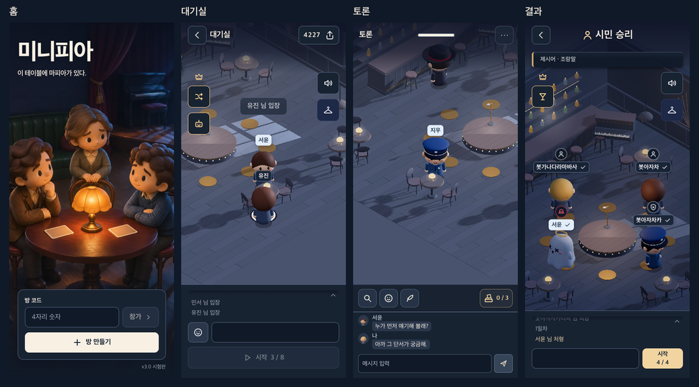

# 미니피아를 다시 설계한다면

2026-11-19 · 게임 디렉터와 게임 디자이너의 독립 평가를 합친 개편 제안서. 기준은 v3 브랜치 `8d45d9a3`와 공통 UI가 반영된 `ff470bb1`의 브라우저 검수 캡처다. 일반방과 실험방의 실제 화면, 서버 판정, 기존 팀 피드백을 대조했다. 지금 버전에서 초심자들이 얼마나 자주 헷갈리는지, 어느 쪽이 더 재미있는지는 새 사람과 검증할 가설이다. 캡처 속 대화는 검수 스크립트가 입력했다. [기존 팀 플레이 기록](playtest-v2.0-feedback.md) · [현 버전 검증 범위](decisions/0099-unified-game-ui.md)

## 게임 디렉터의 평가

**플레이어가 기억해야 할 순간은 “서윤의 말을 듣고 지우에게 주려던 표를 바꿨다”다. 현재 게임은 그 순간보다 표결에 입장하는 절차를 더 정교하게 만들었다.** 첫날 각자 단서를 쓰고 남의 답을 인용해 되물을 수 있다는 점은 살릴 가치가 크다. 말을 잘 못하는 사람도 대화에 가져올 구체적인 소재가 생기고, 마피아는 들키지 않을 만큼만 구체적으로 말해야 한다. 이 긴장이 다음 날까지 이어지는지가 게임의 성패다. [단서 인용 설계](decisions/0094-v3-discussion-and-deduction.md)

| 장면 | 현재 규칙과 문제 | 개편 판단 |
|---|---|---|
| 첫 단서 | 일반방에서 제시어를 읽는 3초 뒤 입력에 주어진 시간은 10초다. 공개 목록은 확정 제출 순, 마감 때 남은 초안, 무응답 순이다. 늦은 답을 의심하면 연기와 한글 입력 속도가 섞인다. 봇은 항상 빈칸이라 봇판에서 이 장치의 재미를 평가하기 어렵다. | 첫 시제품은 실험방의 입력 여유와 좌석순 일괄 공개를 사용한다. 말의 내용을 물었는지, 늦게 쓴 사람을 탓했는지를 구분해 관찰한다. [제출·공개 규칙](decisions/0091-v3-keyword-day-one.md) |
| 토론과 표결 | 일반방은 토론 종료 요청, 처형 실시 찬반, 찬성 시 순차 지목을 거친다. 누굴 의심하는지는 세 번째에야 입력한다. 8명 순차 지목만 최장 76.2초다. 실험방은 첫날에만 사람 한 명 또는 보류를 동시에 고르고, 둘째 날에는 일반 절차로 돌아간다. | 시제품에서는 **매일 같은 한 번의 동시 표결**을 쓴다. 보류와 동률의 결과를 표결 화면에 알린다. 대기 시간은 줄지만 다른 사람의 지목을 보고 판단하던 재미도 줄 수 있다. 집계만 보여 주는 판과 마감 뒤 공개 지목을 보여 주는 판에서 다음 토론을 비교한다. [일반 규칙](../shared/game/phases.ts) · [실험 규칙](../shared/game/playtest.ts) |
| 시민의 밤 | 일반방 시민은 사람을 골라도 그 선택이 누구의 생사나 조사 결과에도 영향을 주지 않는다. 4인 중 2명, 8인 중 4명이 시민이다. 아무 효과도 없는 선택을 능력처럼 제시하면 다음번에 진짜 선택도 믿기 어렵다. | 시민에게는 “아침을 기다려요”와 준비 완료를 보인다. 직업에는 “조사할 사람”, “지킬 사람”처럼 효과를 쓴다. 공개 마감은 역할과 무관하게 같다. 기다림이 길다는 관찰이 있을 때 개인 메모를 시험한다. [밤 판정](../shared/game/night.ts) · [인원별 역할](../shared/game/roles.ts) |
| 둘째 날의 추리 | 첫날의 공개 발언은 기록에 남는다. 그런데 둘째 날 토론 도구는 해당 아침의 희생자와 유언을 찾은 경우에만 인용 자료를 준다. 전날 말이 남아 있는데도 돋보기를 열면 “공개된 단서가 없어요”를 만날 수 있다. | 오늘 아침 결과 옆에 어제의 공개 단서·의심 표시를 연결한다. “어제 민서가 한 말”에서 곧바로 되묻게 한다. 사망자가 없거나 재접속했을 때도 남아 있는 공개 사실을 읽을 수 있어야 한다. 사실의 출처와 플레이어가 한 주장은 구별한다. [토론 근거 구성](../src/game/discussionEvidence.ts) · [토론 화면](../src/screens/PlaytestDiscussion.tsx) |
| 4인의 승부 | 4인은 마피아 1, 경찰 1, 시민 2다. 낮에 시민 편 한 명을 잘못 처형하고 밤에 한 명이 더 죽으면 1대1 동수로 마피아가 이긴다. 첫 추측을 수정할 기회가 아예 없는 합법적인 판이다. | 4인에서 보류가 합리적인 선택임을 먼저 보이고, 첫 오판 뒤 바로 끝난 판의 빈도와 만족도를 따로 본다. 반복적으로 허망하다는 반응이 나오면 4인 한정 첫날 표식을 남기고 탈락을 하루 미루는 안을 비교한다. 더 긴 판이 무조건 좋은 것은 아니다. [배역표](../shared/game/roles.ts) · [승리 조건](../shared/game/win.ts) |
| 탈락과 재경기 | 유령과 결과의 역할 공개는 누가 마피아였는지 알려 준다. 결과 첫 화면에는 승리 진영·제시어·준비 수가 보인다. 판을 뒤집은 거짓말은 흩어진 대화에서 직접 찾아야 한다. | 탈락자는 남은 사람의 선택을 지켜볼 쟁점 하나를 고를 수 있게 시험한다. 결과에는 실제 발언 한 줄, 표결 결과, 승리 조건에 도달한 순간을 시간순으로 놓는다. 기록에 없는 개인의 표나 의도는 추정해서 쓰지 않는다. 바로 옆에 같은 멤버로 다시 시작하는 행동을 둔다. [결과 패널](../src/game/resultText.ts) |

## 게임 디자이너의 평가

**홈에서 가장 좋은 에셋은 램프 자체가 아니다. 그 불빛 아래 세 사람이 서로의 표정을 보고 있다는 구도다.** 실제 일반방 토론 캡처에서는 내 모자가 눈을 가리고 멀리 있는 사람은 등을 보인다. 화면 아래에서 서윤이 말을 하는 동안 중앙에는 테이블과 빈 바닥이 있다. 플레이어가 읽어야 하는 얼굴·이름·발언이 화면 세 곳에 흩어져 있다. [일반방 토론 원본](../design/v3.0/review-2026-11-19/game-390x844-normal-discussion.png)

### 첫 화면에 나온 세 사람을 게임에서 만날 수 없다

홈 원화에는 머리를 올려 묶고 램프 뒤에 선 인물과 양옆에 앉은 두 사람이 있다. 홈과 초대 미리보기는 이 원화를 공유하지만, 대기실과 투표는 별도로 만든 8개 좌석 캐릭터와 초상을 사용한다. 홈에서 본 세 사람을 같은 얼굴과 차림으로 알아볼 대응 캐릭터가 없다. 처음 온 사람에게 홈은 곧 플레이할 게임의 첫 장면이다. 방에 들어가자마자 등장인물이 전부 바뀌면 자신이 기대한 게임에 들어왔는지부터 의문이 생긴다. [홈·대기실 실제 화면](../design/v3.0/review-2026-11-19/board-preview.png) · [홈 원화](../public/backgrounds/noir-entry.webp) · [좌석 캐릭터 목록](../src/net/assets.ts) · [초대 이미지 생성](../scripts/make-og.mjs)

아트 개편에서는 기준이 될 캐릭터부터 정한다. 추천안은 실제 플레이할 캐릭터 셋을 골라 램프를 사이에 둔 홈 구도를 다시 연출하고, 그 그림을 초대에도 쓰는 것이다. 반대로 홈의 세 사람이 원하는 아트 방향이라면 이들을 먼저 대기실 모델과 투표 초상으로 구현한다. 어느 쪽이든 홈 속 한 명을 가리켰을 때 이름표 없이 대기실과 투표에서 같은 사람을 찾을 수 있는지 확인한다.

### 투표함에서 드러나는 설계 문제

| 화면 | 플레이어가 보는 것 | 눌렀을 때 실제로 일어나는 일 | 시제품의 표시 |
|---|---|---|---|
| 일반방 토론 | 투표함과 `0/3` | 4인 예시에서 과반 3명 중 내 종료 동의를 추가하거나 취소한다. 후보에게 표를 주지 않는다. | `토론 마치기` / `3명 동의하면 투표로 이동`. 누른 뒤 `동의함 · 취소`. 요청 수는 조건 옆에 둔다. |
| 일반방 찬반 | `낮 · 찬반`, 같은 금빛 테두리의 `찬성`과 `반대` | 후보를 정하기 전에 오늘 처형 절차를 열지 정한다. | 기존 규칙을 유지하는 비교판에는 `오늘 한 명을 지목해 처형할까요?`와 `지목 진행 / 오늘은 넘기기`를 쓴다. 단일 표결안에서는 이 화면을 없앤다. |
| 실험방 첫 표결 | 후보 얼굴·이름, `오늘은 안 뽑기` | 특정인 또는 보류에 표가 들어간다. 유일한 최다 후보의 표가 보류를 넘어야 그 사람이 뽑힌다. | `오늘 누구를 지목할까요?` 아래 후보와 보류를 둔다. 눌렀을 때 `지우에게 투표함` 또는 `오늘은 보류함`을 표시한다. |

일반방의 사회자 문구에는 이미 “오늘 처형할까요?”가 있다. 현재 화면은 이 안내를 스크린리더 전용으로 숨긴다. 현재 규칙을 바로 이해시키는 가장 싼 수정은 이 한 문장을 두 버튼 옆에 보이는 것이다. [사회자 문구](../src/game/hostLine.ts) · [안내 표시 분기](../src/components/v2/HostBand.tsx)

숫자의 분모는 실제 규칙에서 가져와야 한다. 실험방 첫 토론은 처음에 사람 전원, 45초 뒤부터 과반 동의로 끝낼 수 있다. 같은 자리에 설명 없이 분모만 바뀌면 참가자가 나갔다고 오해할 수 있다. 빨리감기 그림 하나로 바꿔도 개인 스킵처럼 보일 수 있다. 행동의 주체와 결과가 보이는 문구가 필요하다. [일반방 찬반 캡처](../design/v3.0/review-2026-11-19/game-390x844-normal-vote.png) · [실험방 첫 표결 캡처](../design/v3.0/review-2026-11-19/game-360x560-experimental-vote.png) · [동의 집계](../shared/game/discussion.ts)

### 장면과 에셋의 우선순위

- **홈과 대기실.** 홈의 방 코드와 방 만들기는 바로 알아볼 수 있다. 반면 대기실의 `시작 3/8`은 정원과 시작 조건을 한 숫자로 표현한다. 네 명이면 시작 가능하다는 사실을 “한 명 더 오면 시작”으로 보여 준다. 친구가 들어오면 빈 의자를 채우고, 초대 코드는 방장과 손님 모두 바로 찾게 한다.
- **역할과 단서.** 종이 제시어 카드의 “제시어는 쓰지 말고 단서를 남겨요”는 좋은 기준이다. 무엇을 보고 무엇을 해야 하는지가 한 문장에 있다. 뒷면만 보이는 역할 카드에는 “눌러서 내 역할 확인”을, 첫 단서에는 본인만 보는지 이후 전원에게 공개되는지도 알려 준다. 제시어 자체를 모르는 마피아에게 맞는 지시를 별도로 쓴다. [역할 문구](../src/game/roleText.ts)
- **토론 도구.** 돋보기는 탐색처럼 보이지만 이미 공개된 남들의 글을 연다. 의심딱지는 도구 선택·접근·이름표 선택이 연결돼야 붙는다. 새 토론 화면은 첫 공개 단서를 작성자 얼굴 옆에 한 줄 노출하고 `모두의 단서`, `인용해 질문`을 붙인다. 의심은 이름에서 바로 `공개 의심 표시`를 고르게 한다. 반응과 유언은 필요할 때 꺼낸다. 공개 의심과 실제 투표의 선택 상태도 서로 달리 표시한다. [딱지 대상 판정](../src/game/suspectView.ts)
- **캐릭터.** 원형 머리와 코트의 실루엣은 작게 그리기 좋다. 다만 얼굴의 윗부분이 모자에 가리고 뒷머리가 화면 대부분을 차지하면 누가 말했는지는 이름표를 읽어야 한다. 4인과 8인에서 정면 또는 ¾ 얼굴로 보이는 좌석을 먼저 설계한다. 머리 모양·옷깃·명도·좌석 표식을 초상화와 3D 양쪽에 반복한다. 지금은 공개 옷장에 실제 직업명인 ‘경찰·의사·마피아’가 있고 후보 초상은 좌석별 고정 그림이다. 경찰모를 보고 기억한 사람을 표결에서 찾기 어렵고, 제복을 역할 단서로 믿을 여지도 있다. 직업을 뜻하는 소품은 비공개 역할 카드와 결과 공개에 집중한다. 색을 지워도 같은 사람을 찾을 수 있어야 한다. [옷장 이름](../src/game/dressText.ts) · [좌석별 초상](../src/net/assets.ts)
- **배경·조명.** 재즈 바의 피아노와 램프, 광장의 시계와 여명은 장소를 구분하기 좋다. 토론에선 바닥 그림자와 소품보다 볼·눈·이름표가 먼저 읽혀야 한다. 바는 호박색 테이블 조명과 청회색 주변광, 광장은 푸른 새벽과 따뜻한 가로등을 쓴다. 두 맵에서 발언자·선택됨·내 차례는 같은 모양으로 표시한다. 밤은 주변을 낮추고 선택할 얼굴의 명도를 보존한다. 8인·작은 화면에서는 무대 배우 전원을 작게 줄이는 대신, 식별 가능한 초상 목록과 발언자 클로즈업을 비교한다. [B안 원화](../design/v3.0/redesign/b-noir.png)
- **시간·선택·결과.** 상단 막대만으로는 10초짜리 입력과 90초짜리 토론의 남은 시간을 가늠하기 어렵다. 시간제 행동에 남은 초를 병기한다. 모든 후보에 같은 황금 광택을 주는 대신 내 선택에만 체크와 이름을 남긴다. 결과는 승리 제목 아래에 이번 판의 실제 단서와 정체를 함께 놓는다. 글을 줄이는 기준은 “이걸 빼도 누른 뒤 일을 예측할 수 있는가”로 삼는다. [현재 타이머와 도구 표시](decisions/0098-fixed-chat-and-phase-gauge.md)

## 권고하는 개편 방향

**친구가 남긴 한 줄의 단서를 읽고, 그 사람에게 되묻고, 들은 답 때문에 누굴 믿을지 바꾸는 테이블 추리극**을 먼저 만든다. 예를 들어 제시어가 ‘양궁’일 때 민서가 “바람이 중요해”라고 썼다면, 지우는 그 말을 눌러 “실내에서도?”라고 되물을 수 있다. 마피아도 답할 수 있고 시민도 대답을 망설일 수 있다. 게임은 대화를 이어 주고 실제로 나온 말을 보관한다. 어느 답이 수상한지는 사람이 정한다.

전면 개작 후보는 **재즈 바 정전 사건**이다. 종이로 먼저 돌린다. 한 사람은 정전 직전 무대에서 본 것을, 다른 사람은 바에서 들은 것을 받는다. 마피아는 일부만 알고 증언한다. 다음 날 “그 시각에 피아노는 자동 연주 중이었다” 같은 사실 하나가 나오면 전날 증언을 다시 해석하게 된다. 사실 두 개만 대조해 정답이 자동으로 나오는 조합은 고친다. 같은 시간에 기존 제시어판보다 구체적인 질문·반박·판단 변경이 반복해서 나올 때만 제작한다.

**공간 추리극**을 택한다면 동선과 목격이 서로 모순되는 판을 만들고, 그 모순 하나만으로 두 사람이 대화하게 해야 한다. 자유 이동의 이유가 생기는 대신 두 맵의 규칙, 작은 폰의 시야, 위치가 곧바로 정답이 되는 경우까지 새로 설계해야 한다. 현 버전에 공개 단서·인용·동시 표결이 이미 있어 테이블안을 먼저 검증하는 비용이 낮다. 테이블안에서 두 번째 토론의 새 근거가 끝내 생기지 않으면, 방 하나와 목격 사건 하나짜리 공간안을 다음 비교 대상으로 삼는다.

## 실행 순서와 판정 기준

아래 수치는 다음 시제품을 채택하거나 고치기 위한 **제안 기준**이다. 현재 성과나 출시 예측치가 아니다.

| 순서 | 담당과 산출물 | 통과 조건과 실패 시 조치 |
|---|---|---|
| 1. 현재판 관찰 | 디렉터·리서처. 일반방 한 판을 같은 공간의 친구와 원격 문자 친구에게 각각 설명 없이 진행한다. 처음 멈춘 순간, 첫 근거 질문, 첫 오표, 탈락자가 기다린 시간, 실제 재시작을 기록한다. | 방장이 알려 준 순간도 기록해 기준선을 만든다. 의미 혼동인지, 글을 읽을 시간 부족인지, 근거 자체가 없는지 가른다. |
| 2. 투표 언어와 규칙 비교 | 디자이너·디렉터. 같은 4인·같은 단서를 넣은 폰 시제품 세 가지를 만든다. 현행, 문구만 고친 현행, 매일 동시 표결안을 비교한다. | 처음 보는 10명 중 8명 이상이 누르기 전 ‘토론 마치기’, ‘사람에게 투표’, ‘오늘 보류’의 결과를 각각 설명한다. 비교 순서를 바꾸고, 오해가 남은 단어를 다시 쓴다. 순차 지목의 공개 정보가 실제 질문을 만드는지도 기록한다. |
| 3. 재즈 바 한 판 | 개발·디자인. 임시 얼굴과 테이블 한 개로 입장→역할→단서→질문→표결→밤→둘째 날→결과까지 연결한다. 서버 판정·역할 비공개·초대·재접속·인용을 재사용한다. | 4~8인 네 그룹에서 대면과 원격 문자를 모두 본다. 4그룹 중 3그룹 이상에서 진행자 도움 없이 다른 사람의 단서를 인용한 질문과 답이 한 번 이상 오간다. 둘째 날까지 간 판에서는 전날 근거를 다시 쓰거나 판단을 바꾼 사례를 따로 기록한다. 실패하면 단서 내용과 질문 동선부터 다시 시험한다. |
| 4. 캐릭터·무대·조작 확정 | 아트·UX. 같은 대화를 기존 자유 카메라, 정면이 보이는 고정 3D 테이블, 2D 얼굴·단서 카드 구도로 보여 준다. 그룹마다 먼저 보는 안을 바꾼다. 8인 캐스트, 긴 이름, 낮·밤, 키보드를 연 360px 화면을 검수한 뒤 광장에 적용한다. | 참가자 10명 중 8명 이상이 “방금 말한 사람”의 얼굴과 이름을 3초 안에 연결하고, 작은 실제 폰에서 그 사람의 단서를 열고 답을 보낼 수 있다. 오인 위치를 고쳐 두 맵·8인에서 다시 본다. |
| 5. 균형과 다시 하기 | 디렉터·검수. 4인과 6~8인의 첫 오처형 뒤 종료 비율, 탈락 뒤 대기, 같은 방 재시작을 별도로 기록한다. 기존판과 개편판의 플레이 순서를 섞고, 재경기는 권유하기 전에 관찰한다. | 투표 근거를 자기 말로 설명한 사람 수, 승패가 갈린 이유를 설명한 사람 수, 실제 한 판 더 한 그룹 수를 분모와 함께 비교한다. 작은 표본의 승률로 역할을 조정하지 않는다. 4인만 반복해서 허망하면 4인 규칙만 재시험한다. |

**첫 제작 범위는 재즈 바 한 곳, 공개 단서, 질문, 동시 표결, 밤 행동, 다음 날과 결과까지다.** 이 판이 재미있으면 두 번째 맵과 캐릭터 전신·조명에 투자할 이유가 생긴다. 첫날 UI만 매끄럽고 둘째 날에 할 말이 사라진다면, 그 시점에 고칠 것은 그래픽 완성도가 아니라 다음 의심을 만들어 내는 게임 규칙이다.
